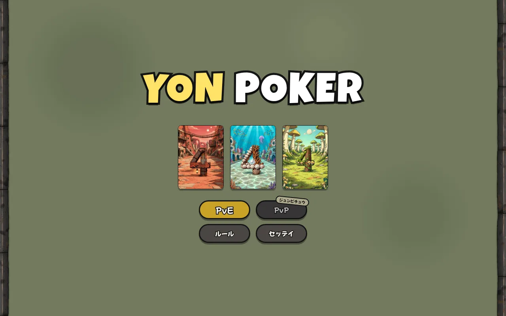
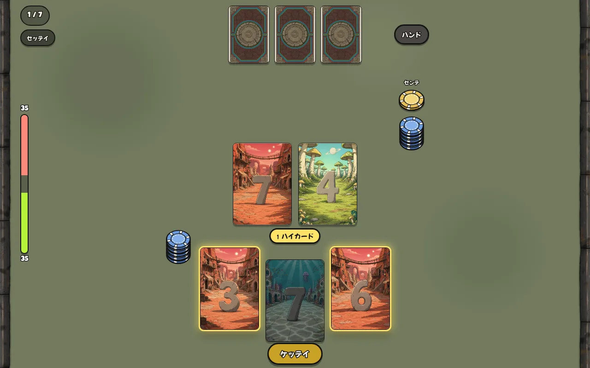
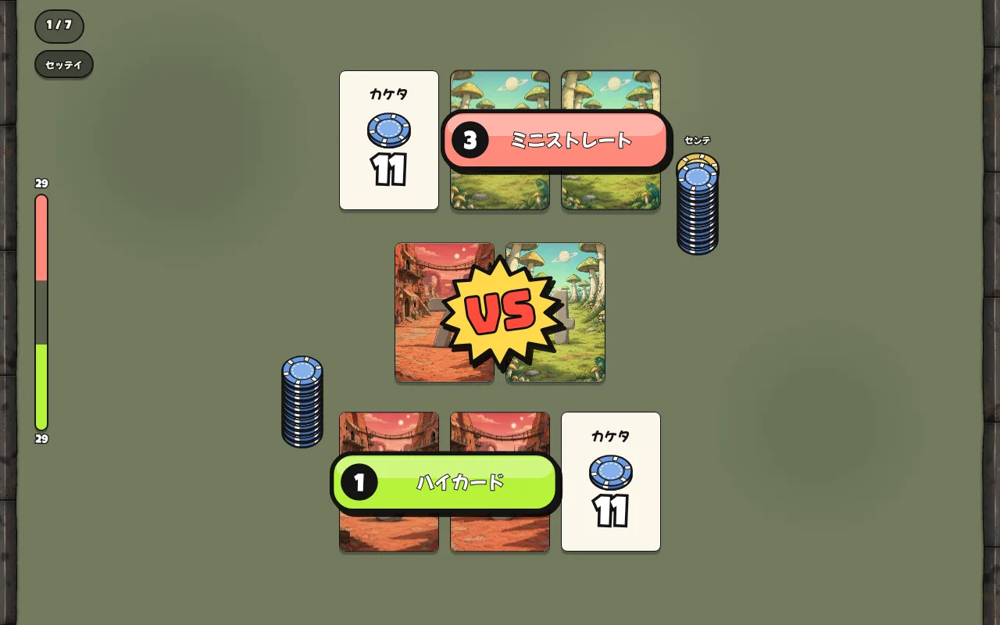

# YON POKER

数字 1〜8 × 3色、24枚のカードで遊ぶ、4枚のポーカー。
手札3枚から2枚を選び、真ん中の2枚と合わせた4枚で役を作ります。
ブラウザだけで遊べます（PvE：コンピューターと対戦）。

## ▶ [ここから遊ぶ](https://yohei-oss.github.io/Game1/)

※ スマホで遊ぶのは、いまはおすすめしません（パソコン推奨）

## あそびかた

### モクテキ
コンピューターと最大7回勝負します。はじめの持ち数はお互い40枚。
7回が終わったとき、持ち数が多い方の勝ちです。

### 1回の流れ
1. 参加料として5枚を出す。カードが配られる。真ん中の2枚は表のままで、お互い同じものを使う。
2. 手札3枚から2枚を選んで「ケッテイ」。残りの1枚は焼ける。選んだ2枚＋真ん中の2枚の4枚で役を作る。
3. 1回目の賭け → お互い、出した2枚のうち1枚を見せる → 2回目の賭け。
4. 対決。役で勝った方が、卓の上のチップを全部もらう。役も数字もまったく同じなら引き分け。

| 2枚を選ぶ | 対決 |
|---|---|
|  |  |

### 試合の終わり
7回が終わるか、どちらかの持ち数が5枚より少なくなったら終わり。最後に持ち数を比べて勝ち負けが決まります。

## カード（24枚）
数字 1〜8 × 背景の色 3つ（赤・青・緑）。同じカードは1枚ずつ。
背景の色が、トランプのマーク（スート）の代わりです。
毎回24枚を混ぜて、真ん中に2枚、お互いに3枚ずつ配ります。

## ハンド（役）

番号が大きいほど強い役です。

| 番号 | 役 | 内容 |
|---|---|---|
| 9 | ストレートフラッシュ | 4枚が同じ色で、数字が続いている |
| 8 | スリーカード | 同じ数字が3枚 |
| 7 | フラッシュ | 4枚が同じ色 |
| 6 | ツーペア | 同じ数字の組が2つ |
| 5 | ストレート | 4枚の数字が続いている |
| 4 | マークツキペア | ワンペア＋残りの2枚が同じ色 |
| 3 | ミニストレート | 3枚の数字が続いている |
| 2 | ワンペア | 同じ数字が2枚 |
| 1 | ハイカード | 役なし（大きい数字で比べる） |

### ゲコクジョウ（2と5のルール）
役の番号の差がちょうど **2** か **5** のときは、弱い方（番号が小さい方）が勝ちます。
それ以外は強い方が勝ちます。同じ役なら、数字の大きさで比べます。

例：
- ワンペア（2）とマークツキペア（4）は差が2なので、ワンペアの勝ち。
- ハイカード（1）とツーペア（6）は差が5なので、ハイカードの勝ち。
- ワンペア（2）とストレート（5）は差が3なので、ふつうに強いストレートの勝ち。

## 賭け
- 先手から順に動きます。先手は1回ごとに交代（1回目はチップの投げ合いで決める）。
- 1回目：ヨウスミ／1マイ／2マイ。2回目：ヨウスミ／1マイ／4マイ。
- 賭けられたら「同じ枚数でカケル」か「倍にしてカケル（上乗せ）」。上乗せは1回の賭けにつき1度だけ。
- 2回目の賭けでは「オリル」もできます。オリたら、それまでに出したチップは相手のものです。
